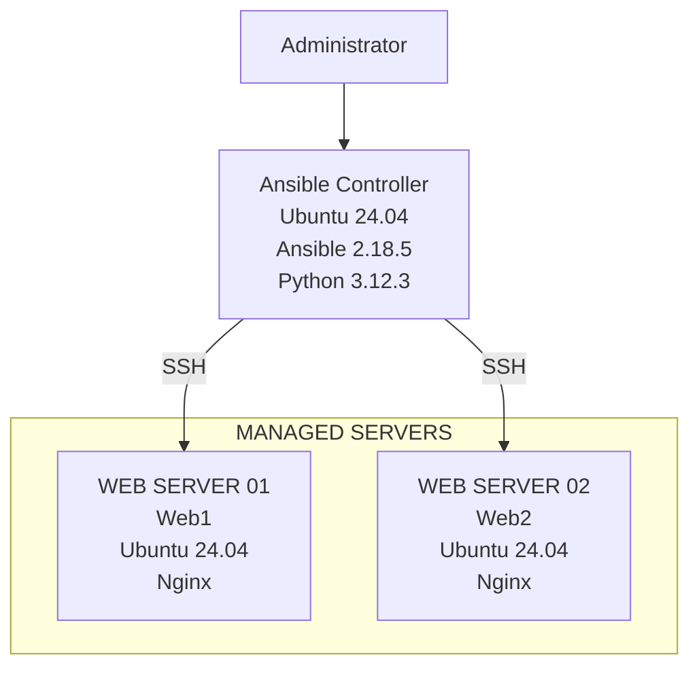
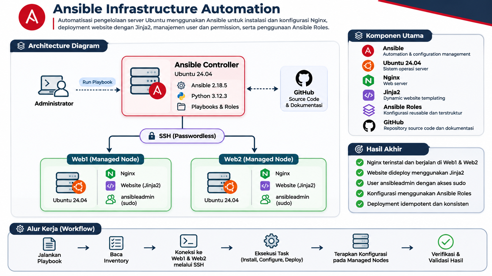
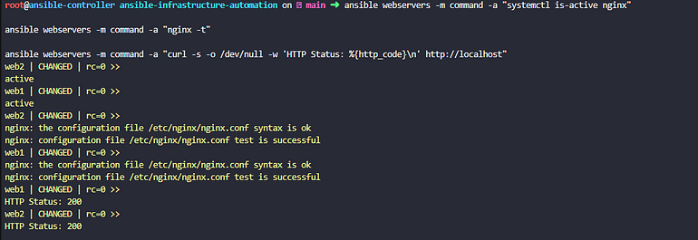

# Ansible Infrastructure Automation

**Otomatisasi Infrastruktur dan Manajemen Konfigurasi Server Menggunakan Ansible**

[](https://www.ansible.com/)
[](https://ubuntu.com/)
[](https://nginx.org/)
[](https://www.python.org/)
[]()

---

## 01. Gambaran Umum Proyek

**Ansible Infrastructure Automation** merupakan proyek implementasi otomatisasi administrasi dan manajemen konfigurasi infrastruktur server menggunakan Ansible.

Proyek ini menerapkan pendekatan *Centralized Configuration Management*, yaitu pengelolaan beberapa server melalui satu Ansible Controller. Seluruh proses instalasi, konfigurasi, deployment, dan validasi dijalankan secara terpusat menggunakan Ansible Playbooks dan Ansible Roles.

Infrastruktur terdiri dari satu Ansible Controller dan dua managed servers berbasis Ubuntu 24.04 yang terhubung melalui SSH.

### Tujuan Proyek

- Membangun sistem pengelolaan infrastruktur secara terpusat.
- Mengimplementasikan konektivitas SSH antara controller dan managed servers.
- Mengotomatisasi instalasi dan konfigurasi Nginx.
- Melakukan deployment website dinamis menggunakan Jinja2.
- Mengotomatisasi pengelolaan user dan sudo permissions.
- Mengembangkan konfigurasi modular menggunakan Ansible Roles.
- Memvalidasi konsistensi konfigurasi melalui idempotency testing.

### Teknologi yang Digunakan

| Kategori | Teknologi |
|---|---|
| Automation | Ansible 2.18.5 |
| Operating System | Ubuntu Server 24.04 |
| Programming Runtime | Python 3.12.3 |
| Remote Management | OpenSSH |
| Web Server | Nginx |
| Templating | Jinja2 |
| Configuration Management | Ansible Roles |
| Version Control | Git |
| Repository | GitHub |

---

## 02. Arsitektur Infrastruktur

Arsitektur menggunakan model centralized management. Administrator menjalankan seluruh proses otomatisasi dari Ansible Controller, kemudian Ansible mendistribusikan konfigurasi ke masing-masing managed server melalui SSH.



### Komponen Infrastruktur

| Server | Fungsi | Sistem Operasi |
|---|---|---|
| Ansible Controller | Menjalankan otomatisasi dan mengelola konfigurasi server | Ubuntu 24.04 |
| Web1 | Managed web server pertama | Ubuntu 24.04 |
| Web2 | Managed web server kedua | Ubuntu 24.04 |

### Alur Kerja Infrastruktur

1. Administrator menjalankan perintah Ansible dari controller.
2. Ansible membaca inventory untuk menentukan target server.
3. Controller membangun koneksi SSH ke seluruh managed servers.
4. Playbook menjalankan task sesuai konfigurasi.
5. Managed servers menerapkan perubahan konfigurasi.
6. Ansible mengumpulkan hasil eksekusi dari setiap server.
7. Administrator melakukan validasi terhadap hasil implementasi.

### Dokumentasi Arsitektur

**Gambar 01 – Infrastructure Architecture**

Diagram berikut memperlihatkan topologi infrastruktur yang terdiri dari satu Ansible Controller dan dua managed servers berbasis Ubuntu 24.04. Seluruh komunikasi dan distribusi konfigurasi dilakukan melalui koneksi SSH.



---

## 03. Implementasi Proyek

### 3.1 Infrastructure Connectivity & System Audit

**Tujuan:** Memastikan Ansible Controller dapat berkomunikasi dengan seluruh managed servers melalui SSH dan berhasil mengumpulkan informasi sistem.

**Implementasi:**

Memeriksa inventory:

```bash
ansible-inventory --graph
```

Menguji konektivitas:

```bash
ansible webservers -m ping
```

Mengumpulkan informasi sistem:

```bash
ansible-playbook playbooks/system-audit.yml
```

Memeriksa hostname:

```bash
ansible webservers -m command -a "hostname"
```

Hasil Validasi:

- Inventory berhasil mengenali grup `webservers`.
- Web1 dan Web2 terdeteksi oleh Ansible.
- Koneksi SSH berhasil dilakukan.
- Kedua managed servers memberikan respons `pong`.
- Informasi sistem berhasil dikumpulkan.

**Dokumentasi Screenshot – Ansible Connectivity**

Gambar berikut menunjukkan proses pemeriksaan inventory, pengujian konektivitas SSH, serta pengumpulan informasi sistem dari kedua managed servers. Hasil pengujian memperlihatkan bahwa Ansible berhasil mengenali Web1 dan Web2 serta memperoleh respons `pong` dari keduanya.


---

### 3.2 Automated Nginx Installation

**Tujuan:** Mengotomatisasi instalasi Nginx pada seluruh managed servers tanpa melakukan instalasi secara manual pada setiap server.

**Implementasi:**

Menjalankan playbook instalasi:

```bash
ansible-playbook playbooks/install-nginx.yml
```

Memeriksa status service:

```bash
ansible webservers -m command -a "systemctl is-active nginx"
```

Memeriksa status enablement:

```bash
ansible webservers -m command -a "systemctl is-enabled nginx"
```

**Hasil Validasi:**

- Nginx berhasil diinstal pada Web1 dan Web2.
- Service Nginx berstatus `active`.
- Nginx dikonfigurasi agar berjalan otomatis saat server melakukan boot.
- Tidak terdapat kegagalan pada proses instalasi.

**Dokumentasi Screenshot – Nginx Installation**

Gambar berikut memperlihatkan eksekusi playbook instalasi Nginx dan pemeriksaan status service pada kedua managed servers. Hasil verifikasi menunjukkan bahwa Nginx berhasil diinstal, berjalan dengan status `active`, dan dikonfigurasi agar aktif secara otomatis ketika server melakukan boot.


---

### 3.3 Dynamic Website Deployment with Jinja2

**Tujuan:** Melakukan deployment website menggunakan Jinja2 Template agar setiap managed server dapat menampilkan informasi berdasarkan identitas server masing-masing.

**Implementasi:**

Menjalankan playbook deployment:

```bash
ansible-playbook playbooks/deploy-template.yml
```

Template website menggunakan variabel dinamis berikut:

| Variabel | Fungsi |
|---|---|
| `website_title` | Judul website |
| `website_heading` | Heading utama website |
| `inventory_hostname` | Identitas hostname server |
| `ansible_distribution` | Distribusi sistem operasi |
| `ansible_distribution_version` | Versi sistem operasi |

Memeriksa hasil deployment:

```bash
ansible webservers -m command -a "curl -s http://localhost"
```

**Hasil Validasi:**

- Template HTML berhasil didistribusikan ke kedua server.
- Website menampilkan judul `Richard Infrastructure`.
- Informasi Infrastructure Engineer ditampilkan.
- Hostname menampilkan identitas masing-masing server.
- Informasi sistem operasi berhasil ditampilkan.

| Server | Hostname |
|---|---|
| Web1 | web1 |
| Web2 | web2 |

**Dokumentasi Screenshot – Jinja2 Website Deployment**

Gambar berikut memperlihatkan hasil deployment website menggunakan Jinja2 Template pada Web1 dan Web2. Website berhasil menampilkan judul Richard Infrastructure, informasi Infrastructure Engineer, hostname, serta informasi sistem operasi secara dinamis sesuai identitas masing-masing server.


---

### 3.4 Nginx Configuration & Ansible Handlers

**Tujuan:** Mengotomatisasi konfigurasi Nginx dan menggunakan Ansible Handlers untuk melakukan restart service ketika terdapat perubahan konfigurasi.

**Implementasi:**

Menjalankan playbook konfigurasi:

```bash
ansible-playbook playbooks/configure-nginx.yml
```

Memvalidasi konfigurasi:

```bash
ansible webservers -m command -a "nginx -t"
```

Memeriksa listening ports:

```bash
ansible webservers -m command -a "ss -tlnp"
```

**Hasil Validasi:**

- Konfigurasi virtual host berhasil diterapkan.
- Nginx menggunakan port 80.
- Document root mengarah ke `/var/www/html`.
- Server name menggunakan `richard.local`.
- Konfigurasi berhasil melewati syntax validation.
- Handler melakukan restart service ketika diperlukan akibat perubahan konfigurasi.

**Dokumentasi Screenshot – Nginx Configuration**

Gambar berikut menunjukkan penerapan konfigurasi virtual host Nginx pada managed servers. Bukti implementasi mencakup pemeriksaan sintaks konfigurasi menggunakan `nginx -t`, validasi listening port, serta penerapan Ansible Handler untuk mengelola restart service ketika terjadi perubahan konfigurasi.


---

### 3.5 Linux User Management & Sudo Configuration

**Tujuan:** Mengotomatisasi pembuatan akun administrator dan pengaturan permission pada seluruh managed servers.

#### A. User Management

Menjalankan playbook:

```bash
ansible-playbook playbooks/manage-users.yml
```

Memeriksa informasi user:

```bash
ansible webservers -m command -a "id ansibleadmin"
```

**Hasil Validasi:**

- User `ansibleadmin` tersedia pada kedua server.
- Home directory berada di `/home/ansibleadmin`.
- Shell menggunakan `/bin/bash`.
- User tergabung dalam grup `sudo`.

**Dokumentasi Screenshot – User Management**

Gambar berikut memperlihatkan proses pembuatan akun administrator menggunakan Ansible serta hasil verifikasi informasi user `ansibleadmin` pada kedua managed servers. Pemeriksaan mencakup UID, GID, grup, home directory, dan konfigurasi shell akun.


#### B. Sudo Configuration

Menjalankan playbook:

```bash
ansible-playbook playbooks/configure-sudo.yml
```

Memvalidasi konfigurasi sudoers:

```bash
ansible webservers -m command -a "visudo -c"
```

Memeriksa ownership dan permission:

```bash
ansible webservers -m command -a "stat -c '%U:%G %a' /etc/sudoers.d/ansibleadmin"
```

Memverifikasi passwordless sudo:

```bash
ansible webservers -m command -a "su - ansibleadmin -c 'sudo -n whoami'"
```

**Hasil Validasi:**

- File sudoers berhasil dikonfigurasi.
- Owner file adalah `root:root`.
- Permission file adalah `440`.
- Passwordless sudo berhasil diverifikasi.


---

### 3.6 Reusable Ansible Roles

**Tujuan:** Mengembangkan konfigurasi Nginx menjadi Ansible Role agar struktur otomatisasi lebih modular, reusable, dan mudah dipelihara.

**Membuat Role:**

```bash
ansible-galaxy init roles/nginx
```

Memeriksa struktur direktori:

```bash
find roles/nginx -maxdepth 3 -type f | sort
```

**Struktur Role:**

```text
roles/
└── nginx/
    ├── defaults/
    │   └── main.yml
    ├── handlers/
    │   └── main.yml
    ├── meta/
    │   └── main.yml
    ├── tasks/
    │   └── main.yml
    ├── templates/
    │   └── index.html.j2
    ├── tests/
    └── vars/
        └── main.yml
```

**Komponen Role:**

| Direktori | Tanggung Jawab |
|---|---|
| `defaults/` | Menyimpan variabel default |
| `tasks/` | Menjalankan instalasi dan konfigurasi |
| `handlers/` | Mengelola restart service Nginx |
| `templates/` | Menyimpan template website |
| `meta/` | Menyimpan metadata role |
| `vars/` | Menyimpan variabel role |

**Menjalankan Role:**

```bash
ansible-playbook playbooks/use-nginx-role.yml
```

**Hasil Validasi:**

- Role Nginx berhasil dipanggil melalui playbook.
- Instalasi dan konfigurasi diterapkan pada kedua server.
- Template website berhasil di-deploy.
- Service Nginx berjalan.
- Handler dijalankan ketika terdapat perubahan yang memerlukan restart.

**Dokumentasi Screenshot – Ansible Role Execution**

Gambar berikut menunjukkan proses pemanggilan dan eksekusi Ansible Role melalui playbook `use-nginx-role.yml`. Eksekusi ini menerapkan konfigurasi Nginx dan deployment template pada kedua managed servers.


---

### 3.7 Idempotency Testing

**Tujuan:** Memastikan Ansible dapat menjalankan konfigurasi berulang kali tanpa menghasilkan perubahan yang tidak diperlukan ketika kondisi server telah sesuai dengan konfigurasi yang diinginkan.

**Proses Pengujian:**

Eksekusi pertama:

```bash
ansible-playbook playbooks/use-nginx-role.yml
```

Eksekusi kedua:

```bash
ansible-playbook playbooks/use-nginx-role.yml
```

Kemudian memeriksa hasil `PLAY RECAP` dari eksekusi kedua.

**Hasil Pengujian:**

| Managed Server | OK | Changed | Failed |
|---|---:|---:|---:|
| Web1 | 6 | 0 | 0 |
| Web2 | 6 | 0 | 0 |

**Analisis Hasil:**

Hasil `changed=0` menunjukkan bahwa eksekusi kedua tidak menghasilkan perubahan konfigurasi yang tidak diperlukan. Kedua managed servers berhasil mempertahankan kondisi konfigurasi yang diinginkan tanpa task yang gagal.

**Dokumentasi Screenshot – Idempotency Testing**

Gambar berikut memperlihatkan hasil eksekusi kedua playbook Nginx Role beserta bagian `PLAY RECAP`. Hasil pengujian menunjukkan Web1 dan Web2 masing-masing memperoleh `changed=0` dan `failed=0`, yang membuktikan bahwa konfigurasi berjalan secara idempotent pada skenario pengujian tersebut.


---

## 04. Final Infrastructure Validation

Setelah seluruh tahapan implementasi selesai, dilakukan validasi akhir untuk memastikan semua komponen berjalan sesuai konfigurasi yang telah ditentukan.

### Validation Commands

**SSH Connectivity**

```bash
ansible webservers -m ping
```

**Nginx Service**

```bash
ansible webservers -m command -a "systemctl is-active nginx"
```

**Nginx Configuration**

```bash
ansible webservers -m command -a "nginx -t"
```

**Linux User**

```bash
ansible webservers -m command -a "id ansibleadmin"
```

**Sudoers Permissions**

```bash
ansible webservers -m command -a "stat -c '%U:%G %a' /etc/sudoers.d/ansibleadmin"
```

**Website HTTP Response**

```bash
ansible webservers -m command -a "curl -s -o /dev/null -w 'HTTP Status: %{http_code}\n' http://localhost"
```

### Final Validation Results

| Komponen Validasi | Web1 | Web2 |
|---|---|---|
| SSH Connectivity | Successful | Successful |
| Nginx Service | Active | Active |
| Nginx Configuration | Successful | Successful |
| User `ansibleadmin` | Available | Available |
| Sudoers Ownership | root:root | root:root |
| Sudoers Permission | 440 | 440 |
| Website HTTP Response | 200 | 200 |
| Role Idempotency | changed=0 | changed=0 |

### Dokumentasi Screenshot – Final Infrastructure Validation

Gambar berikut menunjukkan hasil pemeriksaan akhir seluruh komponen infrastruktur pada Web1 dan Web2. Validasi mencakup konektivitas SSH, status service Nginx, validitas konfigurasi, ketersediaan user administrator, permission sudoers, HTTP response website, serta hasil pengujian idempotency.

Hasil pemeriksaan memperlihatkan bahwa kedua managed servers berhasil mempertahankan konfigurasi sesuai kondisi yang diharapkan.


---

## 05. Struktur Repository

Seluruh source code, konfigurasi, automation playbooks, dan dokumentasi proyek dikelola menggunakan Git dan disimpan pada GitHub.

```text
ansible-infrastructure-automation/
│
├── inventory/
│
├── playbooks/
│   ├── system-audit.yml
│   ├── install-nginx.yml
│   ├── deploy-template.yml
│   ├── configure-nginx.yml
│   ├── manage-users.yml
│   ├── configure-sudo.yml
│   └── use-nginx-role.yml
│
├── roles/
│   └── nginx/
│       ├── defaults/
│       ├── handlers/
│       ├── meta/
│       ├── tasks/
│       ├── templates/
│       ├── tests/
│       └── vars/
│
├── docs/
│   └── screenshots/
│
├── ansible.cfg
└── README.md
```

*Catatan: Struktur di atas menggambarkan komponen proyek berdasarkan dokumentasi. Sesuaikan dengan struktur aktual repository apabila terdapat perbedaan.*

### GitHub Repository

[RichardAkbar/ansible-infrastructure-automation](https://github.com/RichardAkbar/ansible-infrastructure-automation)

---

## 06. Technical Skills Demonstrated

| Area | Implementasi |
|---|---|
| Infrastructure Automation | Otomatisasi administrasi server |
| Configuration Management | Pengelolaan konfigurasi terpusat |
| Linux Administration | Pengelolaan Ubuntu Server |
| Remote Administration | SSH-Based Management |
| Web Server Management | Instalasi dan konfigurasi Nginx |
| Templating | Dynamic Configuration menggunakan Jinja2 |
| Automation Architecture | Ansible Playbooks dan Roles |
| Service Management | Ansible Handlers |
| Access Management | Linux User dan Sudo Permissions |
| Reliability | Idempotency Testing |
| Validation | Infrastructure Health Checks |
| Version Control | Git dan GitHub |

---

## 07. Kesimpulan

Proyek Ansible Infrastructure Automation berhasil membangun sistem otomatisasi pengelolaan dua managed servers Ubuntu 24.04 menggunakan satu Ansible Controller.

Implementasi mencakup konektivitas SSH, system audit, instalasi dan konfigurasi Nginx, deployment website menggunakan Jinja2, pengelolaan user dan sudo permissions, serta penerapan reusable Ansible Roles.

Hasil validasi menunjukkan bahwa kedua managed servers berhasil menjalankan Nginx, menampilkan website dengan HTTP response `200`, dan mempertahankan konfigurasi yang konsisten ketika role dijalankan kembali.

Melalui proyek ini, pendekatan otomatisasi berhasil diterapkan untuk menggantikan proses administrasi server yang sebelumnya dilakukan secara manual dengan proses yang lebih terstruktur, konsisten, dan dapat diulang.

**Project Status: Implementation and Validation Completed.**

---

<sub>Project: Ansible Infrastructure Automation</sub>

<sub>Platform: KodeKloud Playground</sub>

<sub>Repository: [GitHub](https://github.com/RichardAkbar/ansible-infrastructure-automation)</sub>